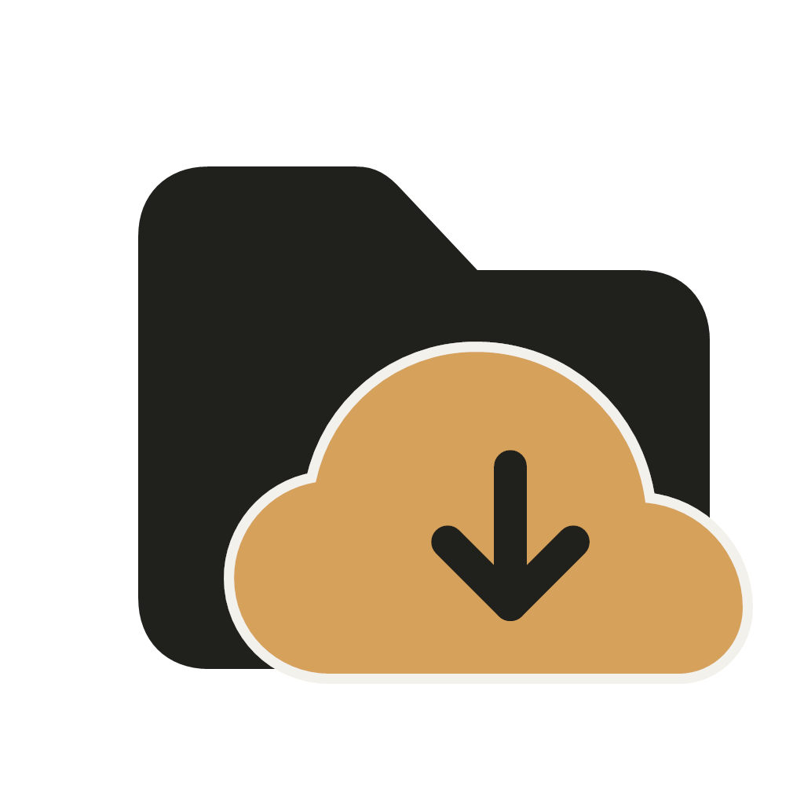
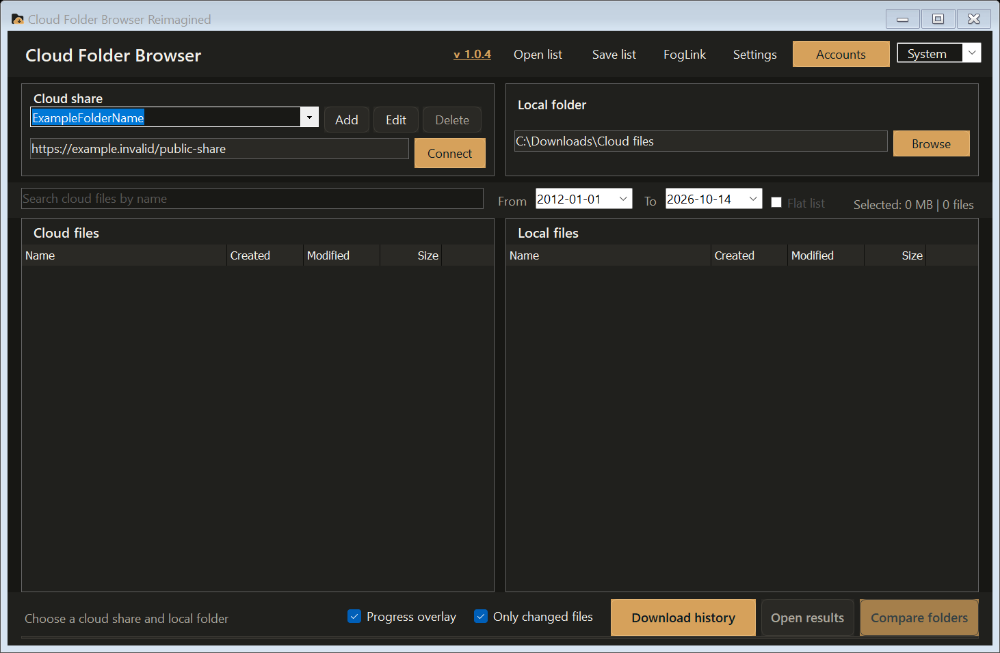

<div align="center">
  
  <h1>Cloud Folder Browser Reimagined</h1>
  <p>Browse public cloud shares, compare them with a local folder, and download the files you need.</p>
  <p>
    <a href="https://github.com/Halo1211/cloud-folder-browser-reimagined/releases/latest"></a>
    <a href="https://github.com/Halo1211/cloud-folder-browser-reimagined/actions/workflows/ci.yml"></a>
    <a href="LICENSE"></a>
    <a href="#requirements"></a>
  </p>
</div>



## Download

Download the EXE or portable ZIP from the
[latest release](https://github.com/Halo1211/cloud-folder-browser-reimagined/releases/latest).
Extract the ZIP into a writable folder and keep `CloudFolderBrowser.dll.config`
beside the executable. The self-contained package includes the .NET runtime.

1. Open the application and add a cloud share.
2. Choose a local folder and select the remote folders to compare.
3. Select **Compare folders**.
4. Review the **Download**, **Overwrite**, **Skip**, or **Rename** actions.
5. Start the transfer. Use **Download history** to resume interrupted HTTP jobs.

The executable is unsigned. Check `SHA256SUMS.txt` from the release before running it.

## Features

- Public-share browsing and local folder comparison.
- Resumable HTTP transfers, validated byte ranges, optional segmented downloads,
  remote checksums, and local SHA-256 manifests.
- Download history, retries, per-host scheduling, priorities, bandwidth limits,
  speed, and estimated completion time.
- Encrypted accounts and share passwords, with automatic direct/debrid routing.
- DNS-over-HTTPS/TLS, custom DNS, HTTP(S)/SOCKS proxies, and per-provider routes.
- Password-encrypted settings backups, JDownloader exports, and optional archive
  extraction and PAR2 repair.
- Light, dark, and system themes, plus a versioned provider plug-in interface.

See the [changelog](CHANGELOG.md) for the changes in v1.0.4.

## Supported sources

| Source | Public-share support | Notes |
| --- | --- | --- |
| MEGA | Files and folders | Native downloads and account imports; eligible debrid routes are optional |
| AllSync / Qloud | Files and folders | Password-protected shares and WebDAV transfers |
| Yandex Disk | Public resources | OAuth tokens support account imports |
| Dropbox | Files and folder ZIP downloads | Private account browsing is not implemented |
| Google Drive | Files and document exports | Docs, Sheets, and Slides exports; public folder browsing is not implemented |
| TeraBox | Share links | Requires an active debrid account that supports the source |
| Generic HTTP(S) | Direct files and hoster links | Some hosters require a configured resolver |
| h5ai / The Trove | Web indexes | Availability depends on the source site |

The account manager also stores and validates WebDAV, Dropbox, Google Drive,
AllDebrid, Real-Debrid, Debrid-Link, Premiumize.me, and TorBox credentials.
Adding an account does not provide private folder browsing for every provider.
Access depends on the provider, account plan, and supported host list.

## Requirements

- Windows 10 or Windows 11, x64.
- For source builds: the .NET 9 SDK selected by [global.json](global.json).

Optional tools:

- [FlareSolverr](https://github.com/FlareSolverr/FlareSolverr) for supported browser challenges.
- JDownloader 2 for exported link packages.
- 7-Zip for RAR, 7z, and password-protected archive extraction.
- PAR2 command-line tools for archive repair.

## Build from source

```powershell
git clone https://github.com/Halo1211/cloud-folder-browser-reimagined.git
cd cloud-folder-browser-reimagined
dotnet restore CloudFolderBrowser.sln
dotnet build CloudFolderBrowser.sln -c Release --no-restore -p:TreatWarningsAsErrors=true
dotnet test CloudFolderBrowser.Tests/CloudFolderBrowser.Tests.csproj -c Release --no-build --no-restore
```

Create the Windows x64 release package:

```powershell
./tools/Build-Release.ps1
```

The script runs the tests, publishes the executable, and creates the ZIP,
release notes, and SHA-256 checksums under `release/`. Local `portable.config`
settings are preserved and excluded from the package. Version tags publish
these assets through GitHub Actions.

See [CONTRIBUTING.md](CONTRIBUTING.md) for development instructions and
[docs/testing.md](docs/testing.md) for test coverage and known limits.

## Data and privacy

Account data, download history, and checksum manifests are stored under
`%LOCALAPPDATA%\CloudFolderBrowser`. Portable settings and saved folder lists
can also reside beside the application or in its working directory.
Credentials and history source URLs use Windows user-scoped encryption.
Exported `.cfbackup` files use password-derived AES-GCM encryption.

Download destinations must use physical folders rather than junctions or
symbolic links. Provider plug-ins execute in-process; install trusted DLLs only.
See [SECURITY.md](SECURITY.md) before sharing logs or reporting a vulnerability.

## Provider plug-ins

Place provider DLLs in a `Providers` directory beside the executable.
Implement `ICloudFolderProviderV2` with a public parameterless constructor.
The v1 interface remains supported.

## Credits and license

Based on [ptrsuder/cloud-folder-browser](https://github.com/ptrsuder/cloud-folder-browser).
The repository includes adapted MEGA, WebDAV, Yandex Disk, and TreeViewAdv libraries;
their directories retain upstream attribution and available license files.

Distributed under the GNU General Public License v3.0. See [LICENSE](LICENSE).
